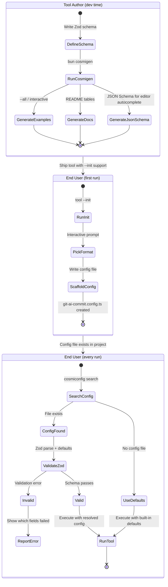
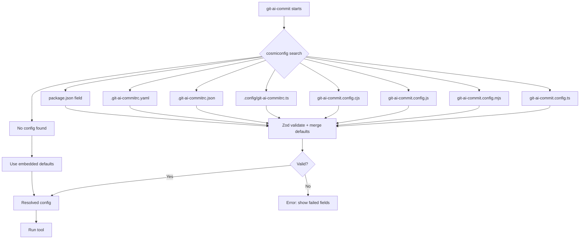
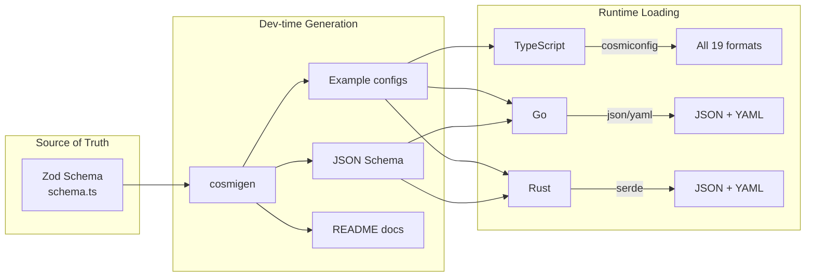

# cosmigen

Generate all [cosmiconfig](https://github.com/cosmiconfig/cosmiconfig)-supported configuration files from a single Zod schema definition.

Define your configuration once in TypeScript with Zod validation, descriptions, and defaults — then generate every file format that cosmiconfig can load, complete with comments and example values.

## Why

Most tools that use cosmiconfig support 15+ configuration file patterns. When you're authoring a configurable tool, you need to:

1. Document every supported format
2. Provide examples for each
3. Explain which formats support which features

cosmigen automates all of this from a single source of truth.

## Install

Built as part of the [bin](../) toolchain:

```sh
bun run build
```

## Usage

### 1. Define your schema

Create `cosmigen.config.ts` in your project:

```typescript
import { z } from 'zod'
import { defineConfig } from 'cosmigen/define'

export default defineConfig({
  name: 'myapp',
  schema: z.object({
    port: z.number().default(3000).describe('Server port to listen on'),
    host: z.string().default('localhost').describe('Hostname for the server'),
    debug: z.boolean().default(false).describe('Enable debug logging'),
    plugins: z.array(z.string()).default([]).describe('List of active plugins'),
    transform: z.function()
      .args(z.string())
      .returns(z.string())
      .optional()
      .describe('Custom transform function applied to output'),
  }),
})
```

### 2. Generate

```sh
# Interactive mode (prompts for format selection)
cosmigen

# Generate all formats
cosmigen --all

# Explicit schema path
cosmigen ./path/to/schema.ts --all

# Preview without writing
cosmigen --dry-run

# JSON output (for piping to other tools)
cosmigen --json

# Custom output directory
cosmigen --out=./generated
```

## Generated Files

For a module named `myapp`, cosmigen generates the following files:

| File | Format | Fidelity |
|------|--------|----------|
| `.myapprc` | JSON | Partial |
| `.myapprc.json` | JSON | Partial |
| `.myapprc.yaml` | YAML | Partial |
| `.myapprc.js` | CommonJS | Full |
| `.myapprc.ts` | TypeScript | Full |
| `.myapprc.mjs` | ES Module | Full |
| `.myapprc.cjs` | CommonJS | Full |
| `myapp.config.js` | CommonJS | Full |
| `myapp.config.ts` | TypeScript | Full |
| `myapp.config.mjs` | ES Module | Full |
| `myapp.config.cjs` | CommonJS | Full |
| `package.json` (field) | JSON | Partial |
| `.config/myapprc` | JSON | Partial |
| `.config/myapprc.json` | JSON | Partial |
| `.config/myapprc.yaml` | YAML | Partial |
| `.config/myapprc.js` | CommonJS | Full |
| `.config/myapprc.ts` | TypeScript | Full |
| `.config/myapprc.mjs` | ES Module | Full |
| `.config/myapprc.cjs` | CommonJS | Full |

## Format Fidelity

Not all configuration formats can represent all JavaScript types. This is the core trade-off documented by cosmigen.

### Full Fidelity Formats

**JavaScript (`.js`, `.cjs`, `.mjs`) and TypeScript (`.ts`)** files can represent any value:

- Functions, async functions, callbacks
- `Date` objects (constructed, not serialized)
- `RegExp` instances
- `Map` and `Set` collections
- `Symbol` values
- Computed/dynamic values
- Conditional logic
- Imported modules

### Partial Fidelity Formats

**JSON** (`.json`, `.rc`, `package.json` field):

| Type | Behavior | Loss |
|------|----------|------|
| `string`, `number`, `boolean`, `null` | Preserved exactly | None |
| `Array`, plain `Object` | Preserved exactly | None |
| `Function` | **Omitted entirely** | Total — no representation possible |
| `Date` | Serialized as ISO 8601 string | Not revived on parse; becomes a string |
| `RegExp` | Stored as string pattern | Loses regex flags and type identity |
| `Symbol` | **Omitted entirely** | Total — no representation possible |
| `Map` / `Set` | **Omitted entirely** | Total — no representation possible |
| `undefined` | Omitted (or becomes `null`) | Semantic difference from explicit null |
| Comments | Not supported in JSON | No inline documentation |

**YAML** (`.yaml`, `.yml`):

| Type | Behavior | Loss |
|------|----------|------|
| `string`, `number`, `boolean`, `null` | Preserved exactly | None |
| `Array`, plain `Object` | Preserved exactly | None |
| `Date` | Native YAML date type | **Revived as Date** — better than JSON |
| `Function` | **Omitted entirely** | Total — no representation possible |
| `RegExp` | Stored as string pattern | Loses regex flags and type identity |
| `Symbol` | **Omitted entirely** | Total — no representation possible |
| `Map` / `Set` | **Omitted entirely** | Total — no representation possible |
| Comments | Supported natively (`#`) | None — cosmigen includes field descriptions |

### The Extensionless `.rc` File

The bare `.myapprc` file (no extension) is ambiguous by design. Cosmiconfig attempts to parse it as **JSON first, then YAML**. cosmigen generates it as JSON, but be aware:

- If your users hand-edit it with YAML syntax, cosmiconfig will still load it
- This can lead to surprising behavior if users assume one format or the other
- Recommendation: prefer the explicit `.rc.json` or `.rc.yaml` variants

### When to Use Which Format

| Use Case | Recommended Format |
|----------|-------------------|
| Simple key-value config | `.rc.json` or `.rc.yaml` |
| Config with functions/callbacks | `.config.ts` or `.config.js` |
| Package-scoped config (no extra file) | `package.json` field |
| CI/automation (checked into git) | `.rc.json` (deterministic, no code execution) |
| Type-safe config with IDE support | `.config.ts` |
| Config that imports other modules | `.config.mjs` or `.config.ts` |

## Schema File Discovery

cosmigen looks for schema files in this order:

1. `cosmigen.config.ts`
2. `cosmigen.schema.ts`
3. `.cosmigenrc.ts`

Or pass an explicit path as the first argument.

## Architecture

cosmigen serves two roles:

1. **Dev-time generator** — Tool authors run `cosmigen` to produce example config files, documentation, and JSON Schemas from a Zod schema definition.
2. **Runtime library** — Tools import cosmigen's core modules to scaffold config files for end users (e.g., `git-ai-commit --init`).

### State Machine

The following diagram shows the complete lifecycle of a cosmigen-powered tool, from schema definition through end-user config loading:



### Config Resolution (TypeScript implementation)



### Polyglot Config Loading

The TypeScript implementation gets full cosmiconfig support (all formats). Go and Rust implementations fall back to static format loading:

| Implementation | Formats Supported | Library |
|---------------|-------------------|---------|
| TypeScript (Bun) | All 19 formats | cosmiconfig + Zod |
| Go (Cobra/Bubbletea) | JSON, YAML, package.json | `encoding/json`, `gopkg.in/yaml.v3` |
| Rust (dialoguer) | JSON, YAML, package.json | `serde_json`, `serde_yaml` |

All implementations share the same Zod schema as source of truth. The JSON Schema generated by cosmigen can be used by Go/Rust for validation, and the JSON/YAML config files are cross-compatible across all implementations.



## API

The core modules can be imported directly for programmatic use:

```typescript
import { introspectSchema, analyzeFidelity, exampleValue } from 'cosmigen/introspect'
import { generateAll, generateFormats } from 'cosmigen/formats'
import { defineConfig } from 'cosmigen/define'
```
